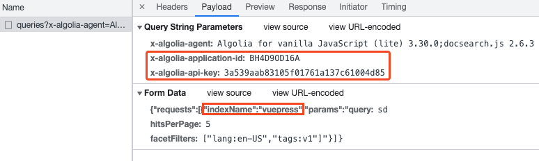
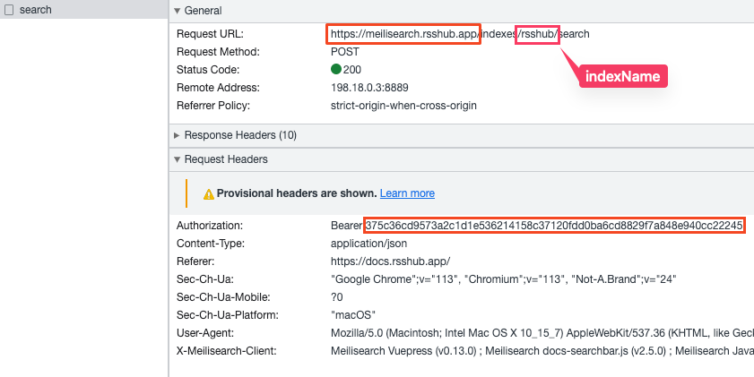
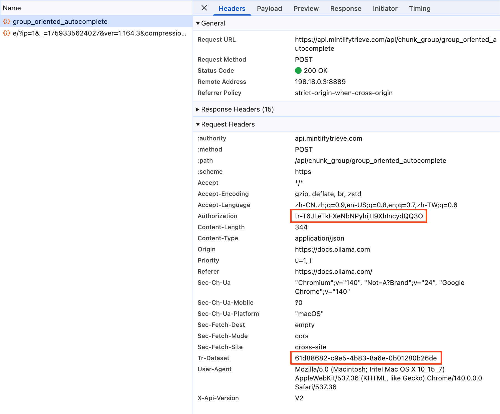

# DocSearch

A unified documentation search tool that integrates search capabilities from multiple technical documentation sites, supporting multiple platforms.

## ✨ Features

- 🔍 **Unified Search** - Search 50+ technical documentation sites in one place
- 🎯 **Multi-version Support** - Support for different languages and versions (e.g., Vue 2/3, React CN/EN)
- 🚀 **Multi-platform** - Available for Raycast, VS Code, Neovim, MCP, and more
- 🔌 **Flexible Backend** - Supports Algolia DocSearch, Meilisearch, Trieve, and more
- 📦 **Monorepo Architecture** - Shared core code with platform-specific builds

## 📱 Supported Platforms

| Platform | Description | Documentation |
| --- | --- | --- |
| **Raycast** | macOS productivity tool extension | [apps/raycast/README.md](apps/raycast/README.md) |
| **VS Code** | Search docs from within the editor | [apps/vscode/README.md](apps/vscode/README.md) |
| **Neovim** | Telescope extension | [apps/neovim/README.md](apps/neovim/README.md) |
| **MCP** | MCP server for AI agents | [apps/mcp/README.md](apps/mcp/README.md) |

## 📚 Supported Documentation (53 documentations | 93 different versions)

|                    Documentations                     |                                                   |                                                     |
| :-------------------------------------------: | :-----------------------------------------------: | :-------------------------------------------------: |
|              [Antd](https://ant.design/)              | [Antdv](https://antdv.com/components/overview-cn) |    [Apollo](https://www.apollographql.com/docs)     |
|         [Arthas](https://arthas.aliyun.com/)          |        [Astro](https://docs.astro.build/)         |       [Bootstrap](https://getbootstrap.com/)        |
|              [Clerk](https://clerk.dev)               |        [Dubbo](https://dubbo.apache.org/)         | [Echarts](https://echarts.apache.org/en/index.html) |
|               [Flet](https://flet.dev/)               |           [Homebrew](https://brew.sh/)            |           [IPFS](https://docs.ipfs.tech/)           |
|            [Laravel](https://laravel.com/)            |          [Nuxt](https://v3.nuxtjs.org/)           |            [NvChad](https://nvchad.com/)            |
|              [Pnpm](https://pnpm.io/zh)               |         [Prettier](https://prettier.io/)          |            [React](https://reactjs.org/)            |
| [React Bootstrap](https://react-bootstrap.github.io/) |     [React Native](https://reactnative.dev/)      |             [Remix](https://remix.run/)             |
|              [Slidev](https://sli.dev/)               |     [Taro](https://docs.taro.zone/docs/4.x/)      |        [Supabase](https://supabase.com/docs)        |
|        [TailwindCSS](https://tailwindcss.com/)        |            [Tauri](https://tauri.app/)            |           [Unidata](https://unidata.app/)           |
|              [Vite](https://vitejs.dev/)              |           [Vitest](https://vitest.dev/)           |       [Vue Router](https://router.vuejs.org/)       |
|               [Vue](https://vuejs.org/)               |           [VueUse](https://vueuse.org/)           |     [Vuepress](https://v2.vuepress.vuejs.org/)      |
|    [ElementPlus](https://element-plus.org/en-US/)     |           [Neovim](https://neovim.io/)            |            [Less](https://lesscss.org/)             |
|            [Sass](https://sass-lang.com/)             |             [Deno](https://deno.com/)             |    [TypeScript](https://www.typescriptlang.org)     |
|           [NextJS](https://nextjs.org/docs)           |      [MassTransit](https://masstransit.io/)       |          [Pinia](https://pinia.vuejs.org/)          |
|          [Yazi](https://yazi-rs.github.io/)           |        [Ollama](https://docs.ollama.com/)         |            [Homarr](https://homarr.dev/)            |
|           [Rsdoctor](https://rsdoctor.rs/)            |          [Rsbuild](https://rsbuild.rs/)           |            [Rspack](https://rspack.rs/)             |
|              [Rslib](https://rslib.rs/)               |           [Rstest](https://rstest.rs/)            |         [Tailscale](https://tailscale.com/)         |
|         [RSSHub](https://docs.rsshub.app/en/)         |          [Rspress](https://rspress.rs/)           |

## 🏗️ Project Structure

DocSearch is organized as a monorepo:

```
docsearch/
├── packages/
│   └── core/              # Shared core code
│       ├── src/data/      # Documentation registry
│       ├── src/clients/   # Search clients (Algolia, Meilisearch, Trieve)
│       ├── src/formatters/# Result formatters
│       └── src/types/     # TypeScript type definitions
└── apps/
    ├── raycast/           # Raycast extension
    ├── vscode/            # VS Code extension
    ├── neovim/            # Neovim Telescope extension
    └── mcp/               # MCP Server (AI Agent integration)
```

### Workspaces

- **`packages/core`**: Shared documentation registry, search clients, formatters, and types
- **`apps/raycast`**: Raycast extension, keeping the standard Raycast extension directory structure
- **`apps/vscode`**: VS Code extension for searching docs from within the editor
- **`apps/neovim`**: Telescope extension and bundled search script
- **`apps/mcp`**: stdio MCP server for AI agent access to the documentation search registry

---

## 🛠️ Development Guide

### Installation

```bash
npm install
```

### Commands

```bash
# Type checking
npm run typecheck

# Run tests
npm run test:core
npm run test:mcp

# Build all packages
npm run build

# Build specific platforms
npm run build:mcp
npm run build:vscode
npm run build:neovim
```

### Adding a New Documentation Source

DocSearch supports three search backends: **Algolia DocSearch**, **Meilisearch**, and **Trieve**.

#### Option 1: Algolia DocSearch

1. Verify that the target documentation site supports [DocSearch](https://docsearch.camunda.com/)
2. Open developer tools and type something in the search bar
   
   

3. Download the site icon and save it to `packages/core/src/assets/logo/`

4. Create a new file in `packages/core/src/data/docs/` (e.g., `vuepress.ts`):

   ```ts
   import { DocItem } from "../types";

   const vuepress: DocItem = {
     // Tag name combining version and language (e.g., "V3 zh-CN", "V2 en-US")
     "V1 zh-CN": {
       icon: "../assets/logo/XXXX.png", // Path to icon
       apiKey: "3a539aab83105f01761a137c61004d85",
       appID: "BH4D9OD16A",
       indexName: "vuepress",
       type: "algolia",
       homepage: "https://vuepress.vuejs.org/",
       /**
        * Optional fields
        * formatter: (item: Array<any>) => FormatResult; // Custom formatter
        */
     },
   };

   export default vuepress;
   ```

5. Import and register it in `packages/core/src/data/apis.ts`

6. Run the commands:
   ```bash
   npm run generate  # Generate entry files and config
   npm run dev       # Test in development mode
   npm run build     # Build
   ```

#### Option 2: Meilisearch

1. Verify that the target documentation site supports [Meilisearch](https://www.meilisearch.com/)
2. Open developer tools and type something in the search bar
   
   

3. Download the site icon and save it to `packages/core/src/assets/logo/`

4. Create a new file in `packages/core/src/data/docs/` (e.g., `rsshub.ts`):

   ```ts
   import { DocItem } from "../types";

   const rsshub: DocItem = {
     "en-US": {
       icon: "../assets/logo/rsshub.png",
       apikey: "3a539aab83105f01761a137c61004d85",
       appid: "bh4d9od16a",
       indexname: "vuepress",
       type: "meilisearch",
       homepage: "https://vuepress.vuejs.org/",
       /**
        * Optional fields
        * formatter: (item: Array<any>) => FormatResult;
        */
     },
   };

   export default rsshub;
   ```

5. Import and register it in `packages/core/src/data/apis.ts`

6. Run `npm run generate`, `npm run dev`, and `npm run build`

#### Option 3: Trieve

1. Verify that the target documentation site supports [Trieve](https://trieve.ai/)
2. Open developer tools and type something in the search bar
   
   

3. Download the site icon and save it to `packages/core/src/assets/logo/`

4. Create a new file in `packages/core/src/data/docs/`:

   ```ts
   import { DocItem } from "../types";

   const config: DocItem = {
     "en-US": {
       icon: "../assets/logo/ollama.png",
       apiKey: "tr-T6JLeTkFXeNbNPyhijtI9XhIncydQQ3O", // Authorization
       datasetId: "61d88682-c9e5-4b83-8a6e-0b01280b26de", // Tr-Dataset
       type: "trieve",
       homepage: "https://docs.ollama.com/",
       baseUrl: "https://api.mintlifytrieve.com",
       searchType: "fulltext",
       /**
        * Optional fields
        * formatter: (item: Array<NewScoreChunk>) => FormatResult;
        */
     },
   };

   export default config;
   ```

5. Import and register it in `packages/core/src/data/apis.ts`

6. Run `npm run generate`, `npm run dev`, and `npm run build`

---

## 🤝 Contributing

Contributions are welcome! To add a new documentation source or improve existing features, please refer to the [Adding a New Documentation Source](#adding-a-new-documentation-source) section above.

## 📄 License

MIT
