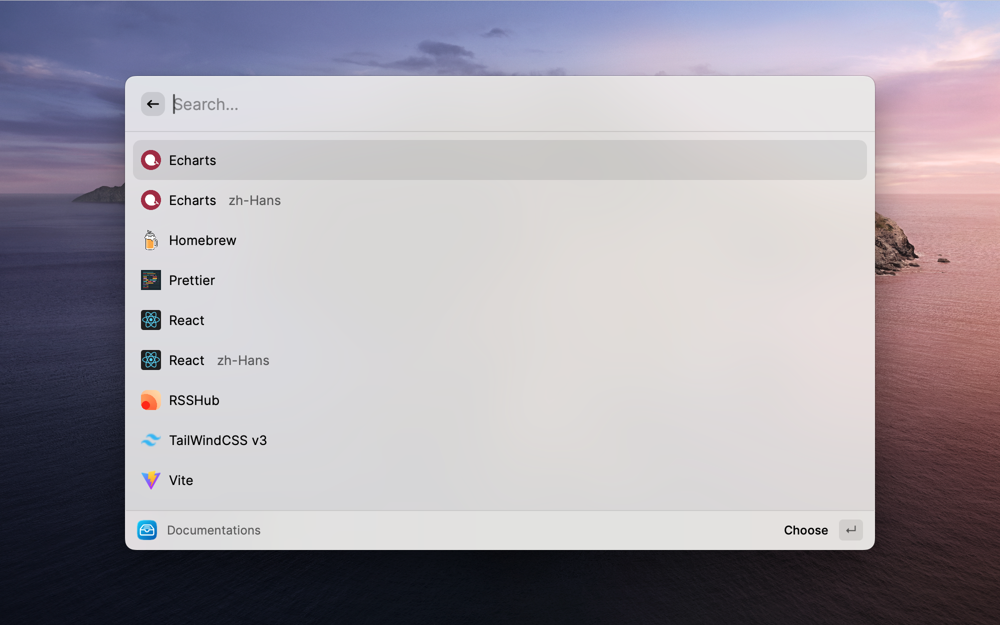

# DocSearch

Link **DocSearch** and **Meilisearch** into Raycast.

### Supported Documentations (53 documentations | 93 different versions)

|                    Documentations                     |                                                   |                                                     |
| :---------------------------------------------------: | :-----------------------------------------------: | :-------------------------------------------------: |
|              [Antd](https://ant.design/)              | [Antdv](https://antdv.com/components/overview-cn) |    [Apollo](https://www.apollographql.com/docs)     |
|         [Arthas](https://arthas.aliyun.com/)          |        [Astro](https://docs.astro.build/)         |       [Bootstrap](https://getbootstrap.com/)        |
|              [Clerk](https://clerk.dev)               |        [Dubbo](https://dubbo.apache.org/)         | [Echarts](https://echarts.apache.org/en/index.html) |
|               [Flet](https://flet.dev/)               |           [Homebrew](https://brew.sh/)            |           [IPFS](https://docs.ipfs.tech/)           |
|            [Laravel](https://laravel.com/)            |          [Nuxt](https://v3.nuxtjs.org/)           |            [NvChad](https://nvchad.com/)            |
|              [Pnpm](https://pnpm.io/zh)               |         [Prettier](https://prettier.io/)          |            [React](https://reactjs.org/)            |
| [React Bootstrap](https://react-bootstrap.github.io/) |     [React Native](https://reactnative.dev/)      |             [Remix](https://remix.run/)             |
|              [Slidev](https://sli.dev/)               |     [Taro](https://docs.taro.zone/docs/4.x/)      |        [Supabase](https://supabase.com/docs)        |
|        [TailwindCSS](https://tailwindcss.com/)        |            [Tauri](https://tauri.app/)            |           [Unidata](https://unidata.app/)           |
|              [Vite](https://vitejs.dev/)              |           [Vitest](https://vitest.dev/)           |       [Vue Router](https://router.vuejs.org/)       |
|               [Vue](https://vuejs.org/)               |           [VueUse](https://vueuse.org/)           |     [Vuepress](https://v2.vuepress.vuejs.org/)      |
|    [ElementPlus](https://element-plus.org/en-US/)     |           [Neovim](https://neovim.io/)            |            [Less](https://lesscss.org/)             |
|            [Sass](https://sass-lang.com/)             |             [Deno](https://deno.com/)             |    [TypeScript](https://www.typescriptlang.org)     |
|           [NextJS](https://nextjs.org/docs)           |      [MassTransit](https://masstransit.io/)       |          [Pinia](https://pinia.vuejs.org/)          |
|          [Yazi](https://yazi-rs.github.io/)           |        [Ollama](https://docs.ollama.com/)         |            [Homarr](https://homarr.dev/)            |
|           [Rsdoctor](https://rsdoctor.rs/)            |          [Rsbuild](https://rsbuild.rs/)           |            [Rspack](https://rspack.rs/)             |
|              [Rslib](https://rslib.rs/)               |           [Rstest](https://rstest.rs/)            |         [Tailscale](https://tailscale.com/)         |
|         [RSSHub](https://docs.rsshub.app/en/)         |          [Rspress](https://rspress.rs/)           |

## Installation

Install from the Raycast Store or by importing this extension.

## Contributing

Want to add a new documentation source? Please refer to the main [README.md](../../README.md#adding-a-new-documentation-source) for detailed instructions.

**Enjoy! Welcome to contribute.**
